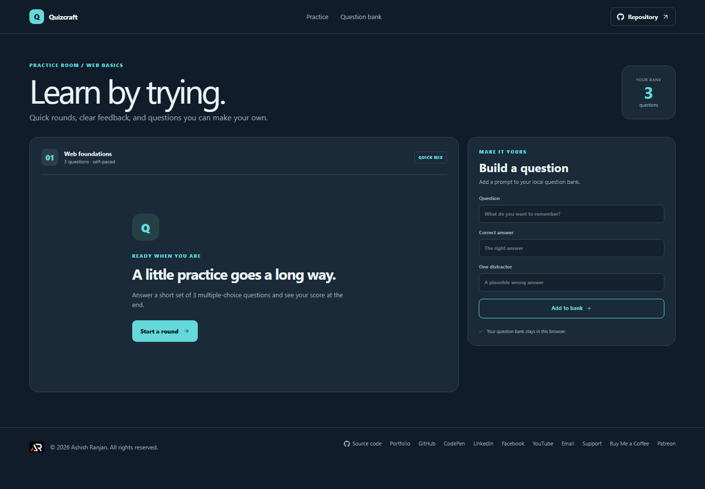

# Quizcraft

Quizcraft lets learners practice a short multiple-choice round and build a small personal question bank.

Live site: https://a2rp.github.io/quiz-practice-builder/

## How to use it

Start a round, choose one answer per question, and move through the set to see a score. Add a prompt, correct answer, and distractor to include a new question in future rounds.

## Features

- Ready-to-use web-foundations questions
- Selectable multiple-choice answers
- Score summary and replay action
- Question builder with a prompt, correct answer, and distractor
- Question bank saved locally in the browser

## Data and limits

Custom questions are stored in localStorage. Round selection and scores stay in page state and reset when you reload.

The question builder currently creates simple multiple-choice items and does not support editing or removing questions.

## Run locally

Install Node.js, then run these commands from the project folder:

    npm install
    npm run dev

## Checks and deployment

    npm run lint
    npm run build
    npm run deploy

The deploy command builds the site and publishes the contents of dist to the gh-pages branch. The project is configured for GitHub Pages at https://a2rp.github.io/quiz-practice-builder/.

## Future improvements

These are ideas only and are not implemented yet:

- Add categories and difficulty levels (idea, not implemented)
- Allow editing and deleting custom questions (idea, not implemented)
- Track past scores and explain answers (idea, not implemented)

## Links

- Portfolio: [https://www.ashishranjan.net](https://www.ashishranjan.net)
- GitHub: [https://github.com/a2rp](https://github.com/a2rp)
- CodePen: [https://codepen.io/ash1198](https://codepen.io/ash1198)
- LinkedIn: [https://www.linkedin.com/in/aashishranjan](https://www.linkedin.com/in/aashishranjan)
- Facebook: [https://www.facebook.com/theash.ashish/](https://www.facebook.com/theash.ashish/)
- YouTube: [https://www.youtube.com/@ashishranjan-ashz?sub_confirmation=1](https://www.youtube.com/@ashishranjan-ashz?sub_confirmation=1)
- Email: [mailto:ash.ranjan09@gmail.com](mailto:ash.ranjan09@gmail.com)

## Support

- Support: [https://a2rp-donation-page.netlify.app/](https://a2rp-donation-page.netlify.app/)
- Buy Me a Coffee: [https://buymeacoffee.com/ashishranjan](https://buymeacoffee.com/ashishranjan)
- Patreon: [https://www.patreon.com/ashishranjan](https://www.patreon.com/ashishranjan)